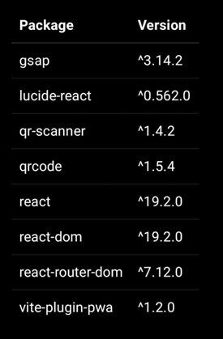
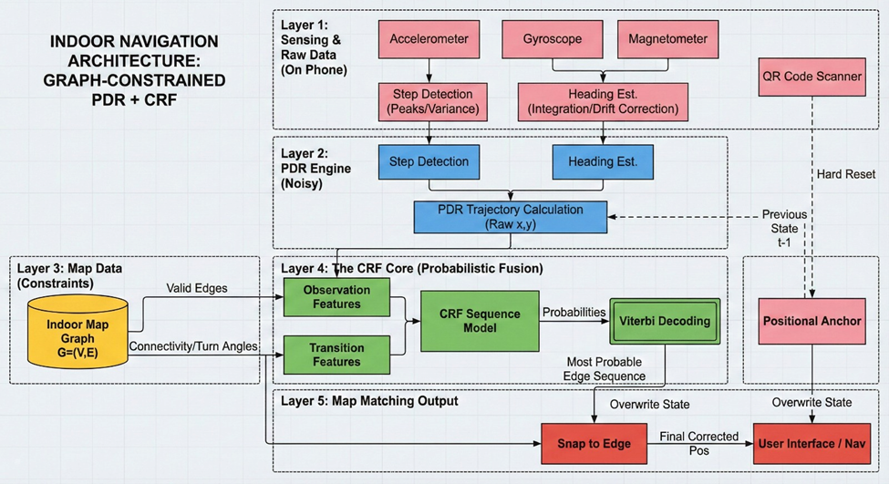
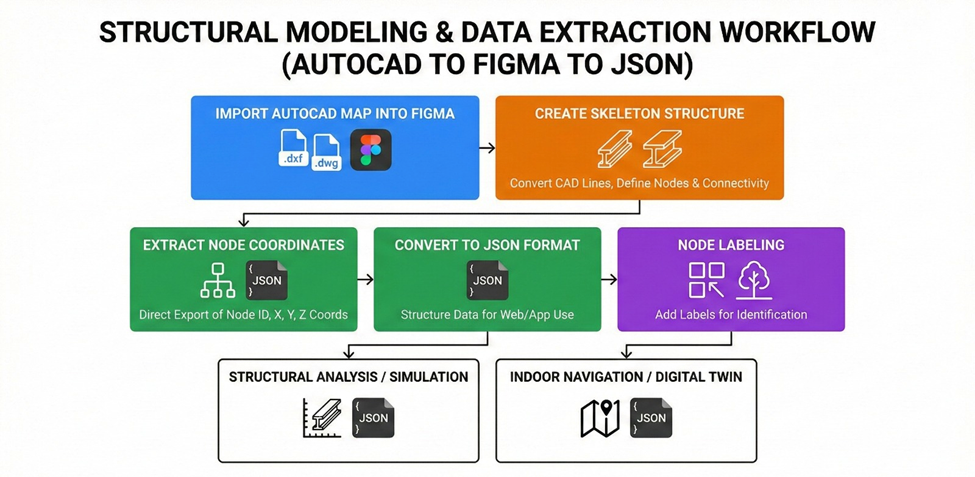
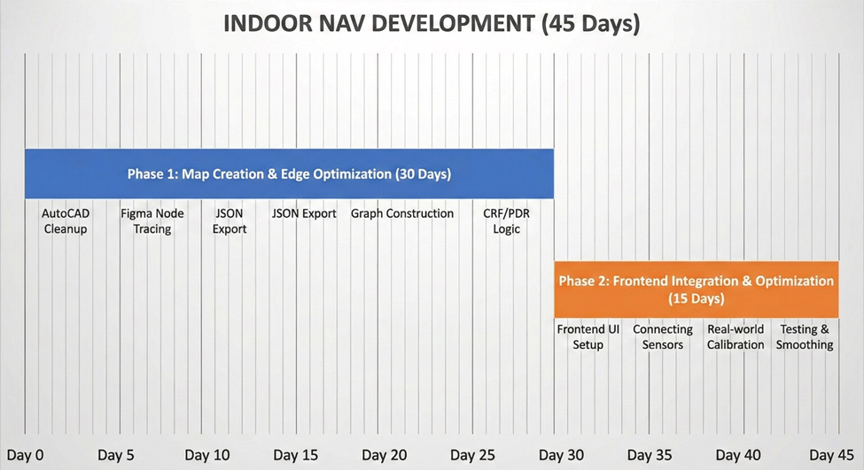

         SIMS Hospital Indoor Navigation System

                                    Software Requirements Specification (SRS)

ANIRUDH SARKAR , CSE ETECH AIML - A , IIIrd YEAR
THILAKH KUMAN , CSE ETCH CSBC,  IIIrd YEAR
SWATHI P , CSE ETCH CS , II YEAR
HARSH SRIVASTAVA.CSE ETECH CS , II YEAR, IIIrd YEAR	

1. Introduction

1.1 Purpose
The purpose of this document is to define the requirements for the SIMS Hospital Indoor Navigation System. This system allows patients, visitors, and staff to navigate the hospital  efficiently using an interactive web-based interface.

 1.2 Scope
The system consists of a web frontend, optimized for mobile devices and a backend server. Users can view floor plans, select destinations (rooms, departments), scan QR codes to determine their current location, and receive visual path guidance to their destination.

2. Overall Description

 2.1 Product Perspective
This system acts as a digital wayfinding assistant, replacing or augmenting physical signage. It integrates with hospital floor plans (SVG maps) and defines a graph network of walkable paths.

2.2 User Classes and Characteristics
- Visitors/Patients: Users unfamiliar with the hospital layout. They require simple, intuitive directions.
- Staff: Users who may need to find specific new locations or assist visitors.
- Administrators: Users responsible for updating map data, node positions, and closing/opening routes (maintenance).

 3. System Features

 3.1 Interactive Map Visualization
- Description: Display high-quality SVG maps of hospital floors.
- Requirements:
    - The map must support panning and zooming.
    - The map must display symbols for distinct landmarks (restrooms, stairs, elevators).
    - Transitions between floors (stairs/elevators) must be clearly handled.

 3.2 Pathfinding and Navigation
- Description: Calculate and display the shortest path between two points.
- Requirements:
    - Users can select a "Start" location (or detect via QR).
    - Users can select a "Destination" from a searchable list of rooms/departments.
    - The system must draw a highlighted line (path) on the map connecting the points.
    - The system should support multi-floor navigation.

 3.3 QR Code Integration
- Description: Determine user location using physical QR codes placed in the hospital.
- Requirements:
    - The application must access the device camera to scan QR codes.
    - Scanning a code automatically sets the "Current Location" on the map.

3.4 Search Functionality
- Description: Find locations by name or category.
- Requirements:
    - Search bar to filter departments, doctors, or room numbers.
    - Selecting a search result highlights it on the map.

 4. Non-Functional Requirements

 4.1 Performance
- Map loading should take less than 2 seconds on 4G networks.
- Path calculation should be near-instantaneous (< 500ms).

 4.2 Usability
- The interface must be mobile-responsive (work well on smartphones).
- Touch targets should be large enough for easy interaction.

 4.3 Reliability
- The system should function even with intermittent internet connectivity (PWA capabilities).

 4.4 Supported Platforms
- Modern Mobile Browsers (Chrome, Safari).
- Desktop Browsers (Chrome, Edge, Firefox).

 5. Technical Constraints
- Frontend: React, TypeScript, Vite.
- Backend: Python (FastAPI).
- Maps: SVG format.
- Data Structure: Graph-based (Nodes and Edges JSON).
		  "BWING STAFF ROOM": {
    "node": "node_009",
    "pic": "EtechStaff2.jpeg"
  },

6. Node packages dependencies 
 
	

7. Architecture design 

   

 

8.
 
 

9 . 

 
*From the day map is provided 
